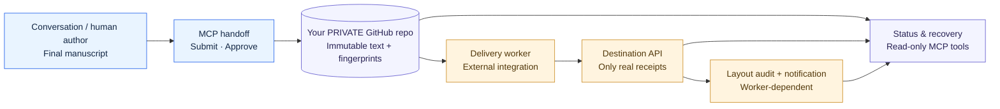

<div align="center">

# Chat Manuscript Bridge

**Write once. Preserve the source. Publish with proof.**

A self-hosted **Model Context Protocol (MCP)** server that turns finished AI-assisted manuscripts into **immutable, source-verified delivery jobs**—without asking another model to rewrite the work.

[](https://github.com/KetenBieber/chat-manuscript-bridge/actions/workflows/ci.yml)
[](pyproject.toml)
[](docs/CLIENT_SETUP.md)
[](LICENSE)
[](docs/ROADMAP.md)

**[Get started](docs/QUICKSTART.md)** · **[Tools](docs/TOOL_CATALOG.md)** · **[Examples](docs/EXAMPLES.md)** · **[Architecture](docs/ARCHITECTURE.md)** · **[简体中文](README.zh-CN.md)**

</div>

---

## Why this exists

Long-form research, technical writing, and working documents are often created over many turns of conversation. Moving the **finished version** to a knowledge base should not require an agent to regenerate, paraphrase, or silently shorten it. It should also be possible to answer: *Which exact version was approved? Did a destination really receive it? Can an uncertain upload be retried safely?*

**Chat Manuscript Bridge separates authorship from delivery.** It keeps the original in your own private GitHub repository, binds each handoff to the content's SHA256 and Git Blob SHA, and exposes clear MCP tools to approve, inspect, and reconcile publication work.

> [!IMPORTANT]
> **Public v0.1 is a trustworthy handoff layer, not a complete Feishu publisher.** The public package implements MCP, GitHub storage, approvals, and verifiable status inspection. **Feishu DOCX import, native equation layout, and IM notification are not shipped in this repository yet.** Those capabilities exist in a separate private production integration and are **not** claimed as features of the public release. An approved job does not imply a published document.

## At a glance

| You want to… | Use | What you actually get |
| --- | --- | --- |
| Preserve a complete manuscript | `submit_manuscript` | Immutable GitHub original, SHA256 + Git Blob SHA |
| Authorize one specific delivery | `approve_publication` | Explicit consent tied to the article's immutable source |
| Save + approve from a conversation | `publish_this_chat` | A durable, approved **job**, not a fabricated destination URL |
| Know what happened | `get_publication_status` | Source-bound status and only real, matching delivery receipts |
| Investigate an uncertain upload | `reconcile_publication` | Read-only recovery instructions; no blind duplicate upload |
| Explore earlier items | `list_manuscripts` | IDs in your private data store |
| Check setup | `inspect_configuration` | Non-secret readiness and integration stage |
| Inspect old private records | `inspect_legacy_article` | Optional, strictly read-only legacy source/receipt audit |

### The workflow



*In v0.1, the external delivery worker and destination-side features are an **integration boundary**, not included runtime components.*

## Quick start

**Requirements:** Python 3.12+, a private GitHub repository for data, and a fine-grained GitHub token scoped to that repository.

```bash
git clone https://github.com/KetenBieber/chat-manuscript-bridge.git
cd chat-manuscript-bridge
python -m venv .venv
source .venv/bin/activate
python -m pip install -e ".[test]"
python -m pytest -q
```

Configure these **in your shell or secret manager**, using [.env.example](.env.example) as the reference:

```dotenv
BRIDGE_GITHUB_REPO=you/private-manuscripts
BRIDGE_GITHUB_TOKEN=<fine-grained-token>
BRIDGE_GITHUB_BRANCH=main
BRIDGE_STORAGE_PREFIX=manuscripts/v1
BRIDGE_ALLOWED_DESTINATIONS=personal-knowledge-base
BRIDGE_TRANSPORT=stdio
```

Start a **local stdio MCP server**:

```bash
python -m chat_manuscript_bridge
```

To connect an MCP-capable client, configure its stdio command and the required environment variables. **The server speaks MCP over stdin/stdout; it is not a regular interactive CLI.** Copyable client configurations for stdio and authenticated HTTP are in **[Client setup](docs/CLIENT_SETUP.md)**; Windows instructions are in **[Quick start](docs/QUICKSTART.md)**.

### Example: publish intent from chat

A compatible client can call:

```json
{
  "tool": "publish_this_chat",
  "arguments": {
    "article_id": "example_robotics_paper_001",
    "markdown": "# Example\n\nA finished, author-approved manuscript.",
    "category": "robotics",
    "destination": "personal-knowledge-base",
    "confirm": true
  }
}
```

The server stores the exact Markdown in **your private repository** and returns the source's actual SHA values and an approved delivery **job**. It does **not** start a Feishu upload in public v0.1. More response examples and failure cases: **[Examples](docs/EXAMPLES.md)**.

## What makes this different

| Principle | Behavior |
| --- | --- |
| **The original is canonical** | No rewriting, trimming, Markdown normalization, or summarization; byte-for-byte storage and readback |
| **Consent is explicit** | An allowlisted destination, an immutable source hash, and `confirm=true` for each article |
| **Retry is not re-upload** | A pending or ambiguous external attempt blocks duplicate publication until reconciled |
| **Every state has evidence** | `saved`, `approved_for_delivery`, `published_api_verified`, `layout_verified` are distinct |
| **Your data stays yours** | Open-source code and real manuscripts live in different repositories; no real tokens or production receipts in this repo |
| **Small, inspectable tools** | Eight purpose-built MCP tools with stable, source-bound responses |

## Documentation

| Guide | Covers |
| --- | --- |
| **[Quick start](docs/QUICKSTART.md)** | Local setup, Python environments, private GitHub token and verification |
| **[Client setup](docs/CLIENT_SETUP.md)** | Stdio, authenticated HTTP, sample configurations, ChatGPT compatibility |
| **[Tool catalog](docs/TOOL_CATALOG.md)** | All 8 tools, inputs, effects, authorization and expected results |
| **[Worked examples](docs/EXAMPLES.md)** | Full synthetic handoff, approval preview, state inspection, recovery |
| **[Architecture](docs/ARCHITECTURE.md)** | Source hashes, private storage protocol and provider boundary |
| **[API contract](docs/API.md)** | Record paths, limitations and exact status definitions |
| **[Roadmap](docs/ROADMAP.md)** | What runs now vs. what remains before a general-purpose Feishu connector |
| **[Security](SECURITY.md)** · **[Contributing](CONTRIBUTING.md)** | Threat model, safe deployment and contribution process |

## A note about ChatGPT connectivity

A GitHub repository, an installed skill, and a connected MCP server are **three different things**. A client must expose and authenticate a real MCP connection before the tools above can be called. Public v0.1 supports stdio and a self-hosted HTTP endpoint protected by a static Bearer token; **some ChatGPT custom MCP connection flows require OAuth and cannot accept that static key directly**. Do not disable authentication to make a UI accept the endpoint. See [Client setup](docs/CLIENT_SETUP.md) and [direct-connection notes](docs/CHATGPT_DIRECT_CONNECTION.md).

## Project status and contributing

This repository is the **public, reusable foundation**. It is not yet a drop-in replacement for an existing private Feishu production pipeline. The remaining provider work must pass source-fidelity, duplicate-prevention, equation/figure layout, and message-delivery acceptance tests before any production migration.

For an issue or enhancement, read [CONTRIBUTING.md](CONTRIBUTING.md). Please use **synthetic examples**—never upload your private manuscript, real Feishu Open ID, tokens, or production evidence.

MIT licensed. See [LICENSE](LICENSE).

<sub>Documentation patterns informed by the official MCP reference servers, GitHub MCP Server, Playwright MCP, and mature Agent Skills projects; see [project references](docs/PROJECT_REFERENCES.md).</sub>
