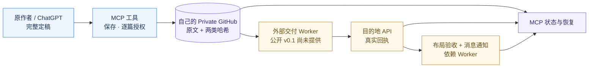

<div align="center">

# Chat Manuscript Bridge

**原稿只写一次，交付过程全程可核验。**

一个可自行部署的 **MCP 论文与长文原稿交接工具**：把对话中已经定稿的文章，原样存入你自己的 Private GitHub 仓库，再用明确的逐篇授权、可查询状态和真实回执完成可审计交付。

[](https://github.com/KetenBieber/chat-manuscript-bridge/actions/workflows/ci.yml)
[](pyproject.toml)
[](docs/CLIENT_SETUP.md)
[](LICENSE)
[](docs/ROADMAP.md)

**[5 分钟入门](docs/QUICKSTART.md)** · **[8 个 MCP 工具](docs/TOOL_CATALOG.md)** · **[实际调用示例](docs/EXAMPLES.md)** · **[架构](docs/ARCHITECTURE.md)** · **[English](README.md)**

</div>

---

## 为什么做这个项目？

AI 对话里一篇长论文往往经过多轮追问和修订，最后定稿才是值得保存的版本。很多“上传文档”流程会再让一个模型总结一遍，导致原有段落、公式、图片说明和细节悄悄丢失；而上传失败之后，用户甚至不知道应该重新发一遍，还是修复已经建立的文档。

**Chat Manuscript Bridge 把文章的写作权与交付权分开：** 原稿由用户和当前对话完成；MCP 保存原始 UTF-8 字节、原稿 SHA256 和真实 Git Blob SHA；发布授权精确绑定该稿；状态查询只依据确实存在的回执。以后添加飞书、Notion 或其他目的地，也遵守同一套不重复上传的原则。

> [!IMPORTANT]
> **公开 v0.1 是原稿交接与状态引擎，不是完整飞书发布器。** 已实现 MCP 连接、私有 GitHub 存储、逐篇授权、状态查询和恢复建议。**飞书 DOCX 上传、原生公式及图片布局验收、飞书消息通知还没有迁移到此公开仓库。** 它们在独立的 Private 生产项目中实现，不能当成这个公开版本已经提供的能力。收到 `approved_for_delivery` 绝不表示文档已经上传。

## 你能用它做什么？

| 工作 | MCP 工具 | 返回的真实证据 |
| --- | --- | --- |
| 保存一份完整定稿 | `submit_manuscript` | 私有 GitHub 原稿、SHA256、Git Blob SHA |
| 授权单篇发布 | `approve_publication` | 与原稿哈希绑定的确认记录 |
| 从聊天一步交接 | `publish_this_chat` | 保存 + 授权结果，**不伪造飞书链接** |
| 查询进度和问题 | `get_publication_status` | 已存在的、来源匹配的状态与回执 |
| 处理不确定结果 | `reconcile_publication` | 只读恢复建议，不会重复上传 |
| 查看自己的文章 | `list_manuscripts` | Private 仓库文章 ID |
| 检查接入配置 | `inspect_configuration` | 不含密钥的环境与能力状态 |
| 检查旧仓库 | `inspect_legacy_article` | 可选的只读历史原稿与交付回执检查 |



## 快速开始

需要 Python 3.12+ 和用于存稿的 **Private GitHub 仓库**。GitHub Fine-grained Token 应只授权该仓库，不要交给模型或提交到公开代码库。

```bash
git clone https://github.com/KetenBieber/chat-manuscript-bridge.git
cd chat-manuscript-bridge
python -m venv .venv
source .venv/bin/activate
python -m pip install -e ".[test]"
python -m pytest -q
```

在环境变量中配置：

```dotenv
BRIDGE_GITHUB_REPO=you/private-manuscripts
BRIDGE_GITHUB_TOKEN=<你的细粒度GitHubToken>
BRIDGE_GITHUB_BRANCH=main
BRIDGE_STORAGE_PREFIX=manuscripts/v1
BRIDGE_ALLOWED_DESTINATIONS=personal-knowledge-base
BRIDGE_TRANSPORT=stdio
```

运行本地 MCP（stdio）：

```bash
python -m chat_manuscript_bridge
```

这条命令供 MCP 客户端通过标准输入/输出连接，**不是用于手工聊天的终端界面**。Windows PowerShell、MCP 客户端配置、Docker / HTTP 部署、鉴权方式见 **[完整入门](docs/QUICKSTART.md)** 与 **[客户端接入](docs/CLIENT_SETUP.md)**。

### 对话提交示例

```json
{
  "tool": "publish_this_chat",
  "arguments": {
    "article_id": "example_paper_001",
    "markdown": "# 示例论文精读\n\n这是作者确认过的完整正文。",
    "category": "robotics",
    "destination": "personal-knowledge-base",
    "confirm": true
  }
}
```

当前公开版本会返回真实的文章指纹、逐篇授权和交付作业状态。**未接入外部 Worker 时不会上传飞书**。完整示例：[查看一次从保存到查询的调用过程](docs/EXAMPLES.md)。

## 设计原则

**原稿保真。** 不重写、不摘要、不做空格或 Markdown 正规化；再次提交同一 ID 时，正文不同就拒绝覆盖。

**最小授权。** 目的地必须在白名单中，文章与 SHA、类别、目的地对应，并由用户对该篇明确确认。

**不重复上传。** 上传结果未知时必须检查已有远端文档，不能因为超时就再生成一个。

**状态有证据。** `saved`、`approved_for_delivery`、`published_api_verified`、`layout_verified` 和 `notification_status=sent` 有不同的验收要求。

**代码数据隔离。** Public 只放通用代码、合成案例、测试与文档；真实原稿、个人凭据和飞书交付记录属于你的 Private 仓库。

## 文档导航

| 文档 | 你会找到什么 |
| --- | --- |
| [Quickstart](docs/QUICKSTART.md) | 安装、Windows/Linux、变量配置、运行与验证 |
| [Client setup](docs/CLIENT_SETUP.md) | stdio/HTTP MCP 客户端配置，ChatGPT 兼容性限制 |
| [Tool catalog](docs/TOOL_CATALOG.md) | 8 个工具的参数、返回、权限与误用防护 |
| [Examples](docs/EXAMPLES.md) | 完整合成文章示例及状态回执 |
| [Architecture](docs/ARCHITECTURE.md) | 架构、私有存储契约和后续迁移边界 |
| [API](docs/API.md) | 数据结构及状态的正式含义 |
| [Roadmap](docs/ROADMAP.md) | 哪些已实现、哪些还没接入 |
| [Security](SECURITY.md) · [Contributing](CONTRIBUTING.md) | 权限、威胁模型和贡献规范 |

## 关于 ChatGPT 连接

**安装 Skill 不等于 MCP 已经连接。** 公开 v0.1 支持本地 stdio 和静态 Bearer 保护的 Streamable HTTP 服务；部分 ChatGPT 自定义 MCP 连接表单只提供 OAuth / 无鉴权，不支持直接输入固定 API Key。不能为了接上而关闭服务端鉴权。完整限制见 [接入说明](docs/CLIENT_SETUP.md)。另一个 Private 项目已经有 GitHub → Railway → 飞书的实际运行通道，它**不是本仓库 v0.1 的一部分**。

MIT 开源。欢迎贡献经过脱敏的 Bug 复现、测试和功能建议；不要上传真实论文、私人飞书 Open ID、Token 或内部回执。参见 [CONTRIBUTING.md](CONTRIBUTING.md)。

<sub>借鉴 Playwright MCP、GitHub MCP Server、官方 MCP Reference Servers、Agent Skills 等项目的信息组织方式，详见 [参考说明](docs/PROJECT_REFERENCES.md)。</sub>
